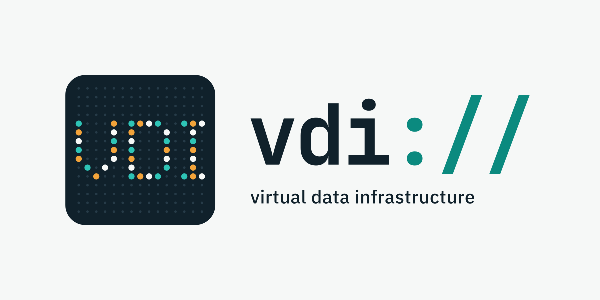
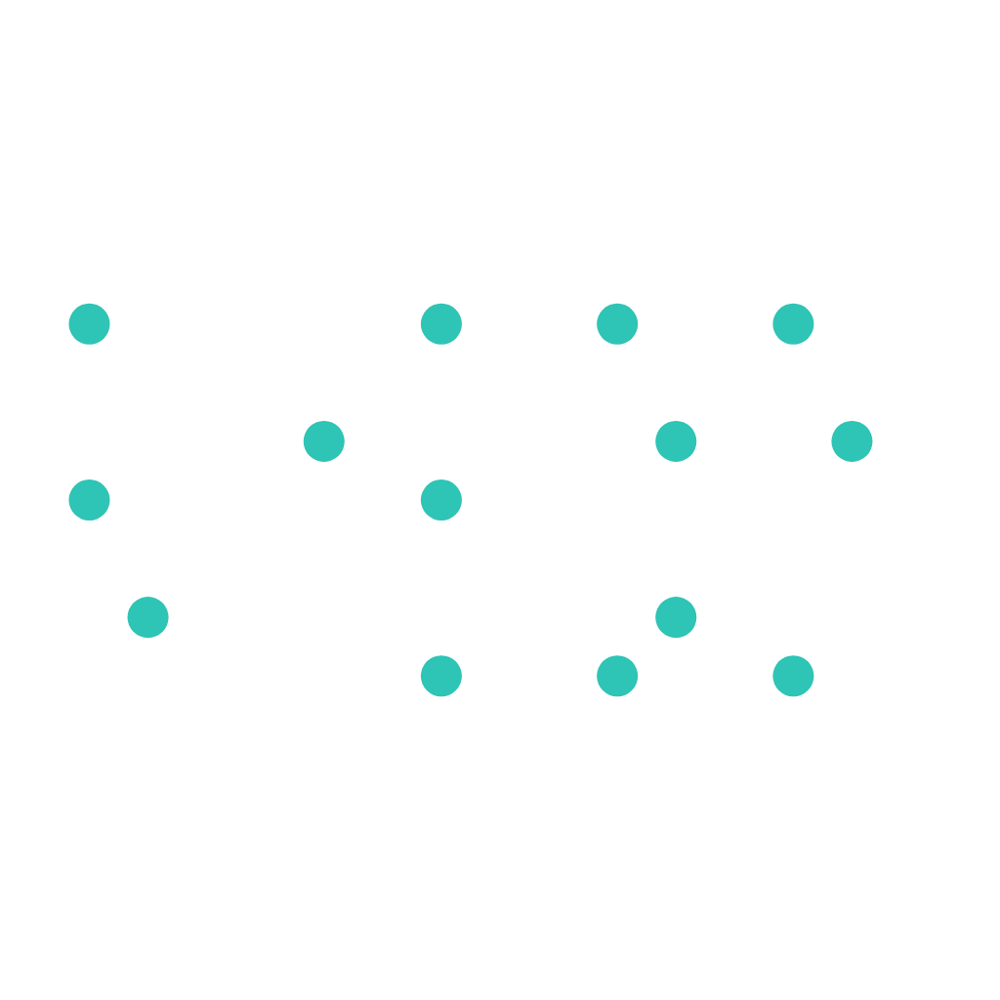
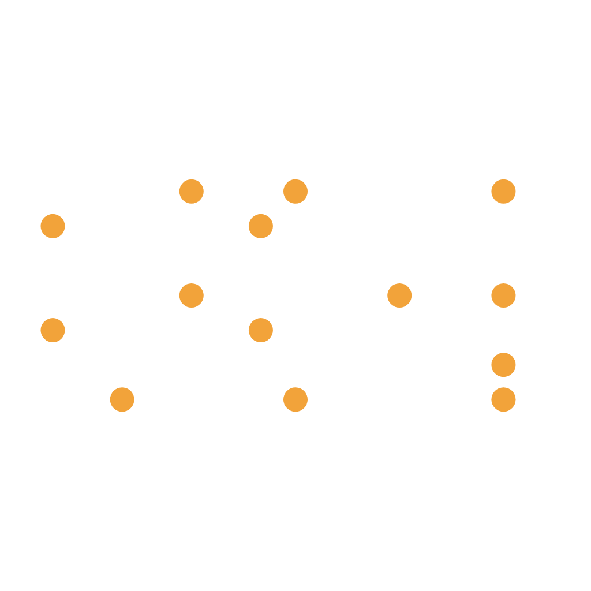
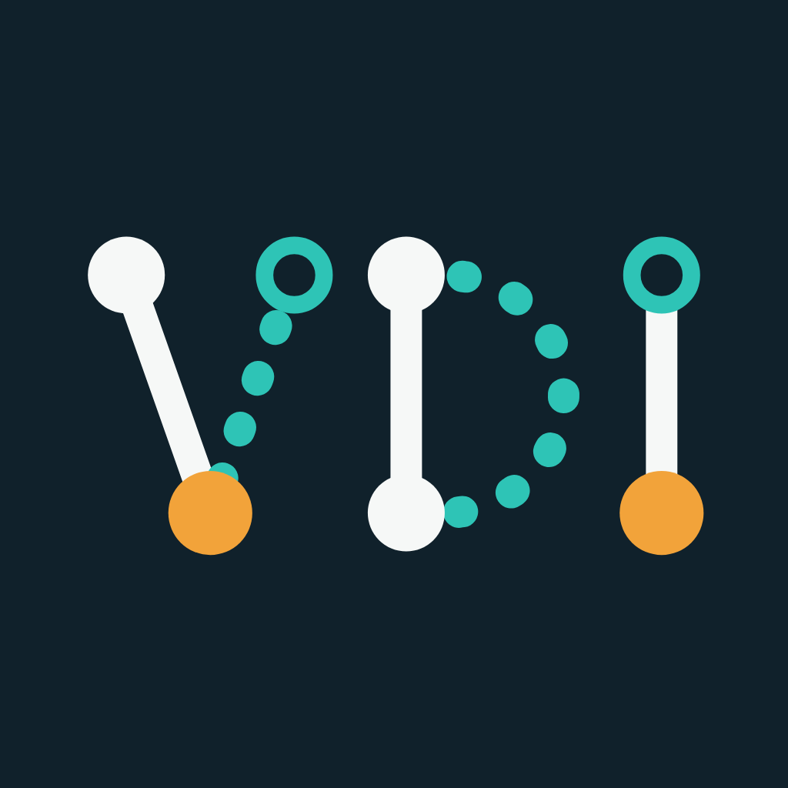

# VDI logo set

Logos for the [virtual data infrastructure](https://github.com/virtual-data-infrastructure) project: what each one shows, why, and where it fits.

All files are in `svg/` (vector) and `png/` (double resolution). Image paths below are relative to this file.

## Shared ideas

Every variant draws on the same few ideas from the project:

- **Data flow graph.** `vdi run` logs each file access and turns the logs into a graph of files and programs. Nodes and edges are the basic vocabulary of the marks.
- **Local and remote data.** VDI makes remote data usable as if it were local. Solid shapes stand for what is on disk, dotted or hollow shapes for what is remote or virtual.
- **A namespace of its own.** `vdi://namespace/path` puts all data behind one prefix. That allows new views and layers of abstraction on top of the same data.
- **Layers.** Several views stacked on the same data give the full picture.

### Colours

| Colour | Hex | Meaning |
| --- | --- | --- |
| Ink | `#10212B` | Background of the icons, text on light ground |
| Light | `#F6F8F7` | Local data, solid strokes, light background |
| Teal | `#2EC4B6` | Remote or virtual data, the tracking layer |
| Dark teal | `#0B8A7F` | The same accent on a light background (`://`) |
| Amber | `#F2A33A` | Results: the data a workflow produces |
| Dim | `#263B48` | Unlit dots of the matrix |

### Type

The wordmark is set in JetBrains Mono Bold, the tagline in IBM Plex Sans Medium. In the SVG files the text is converted to outlines, so no fonts are needed.

## The logos

### 1. Lockup: matrix mark and `vdi://`

Files: `logo-lockup` (light background), `logo-lockup-transparent`

The primary logo. The wordmark is written as `vdi://`, the URL scheme the project introduces. It says in five characters that VDI is a namespace: a place where data gets an address independent of where it is stored, and on which further views can be built. The monospace face refers to the command line, where the tool is used. The mark on the left is the matrix icon described next.

### 2. Matrix icon

Files: `icon-matrix`, `icon-matrix-transparent`, `matrix-background-grid`

A 15×15 grid of dots, most of them dim. The lit ones spell VDI. The grid stands for the mass of raw data and log records: mostly noise until something organises it. The letters appear only as a pattern across many small points, the way a data flow graph emerges from thousands of single log lines.

### 3. The three layers

| Layer 1 | Layer 2 | Layer 3 |
| --- | --- | --- |
|  |  |  |

Files: `matrix-layer-1-transparent` (light), `matrix-layer-2-transparent` (teal), `matrix-layer-3-transparent` (amber)

Note: the images have transparent backgrounds and the first layer is near white, so view them on a dark background.

The lit dots are split evenly over three layers, 14 dots each. A single layer looks like scattered points. Only when all three are placed on top of each other does VDI become readable. This is the layering idea made literal: each view on the data is incomplete, and the infrastructure is what brings them together.

### 4. Animated matrix

Files: `icon-matrix-animated.gif`, `svg/icon-matrix-animated.svg`

The same idea over time: an empty grid, then the light layer, then teal, then amber, and finally all three together. The loop takes 7.2 seconds.

### 5. Graph icon

File: `icon-vdi-graph`

The letters V, D and I drawn as small data flow graphs. In the V, a solid arm (local data) and a dotted arm from a hollow node (remote data) meet in an amber result node. The D has a solid stem and a dotted bowl, the I runs from a hollow node to a result. It is the most literal variant: it reads as "VDI" at once.

### 6. Wrapped program

File: `icon-wrapped-program`

A letterless mark for the tracking mechanism of `vdi-client`. A file (square) flows through a program (circle) into a result file (amber square). The dotted teal ring around the program is the wrapper library, which sits around every run and records each file access without interrupting it. The dots of the ring are the individual log records.

### 7. Data fabric

File: `icon-data-fabric`

A woven grid of threads for the "data fabric" idea: many data flows interlaced into one structure. One amber thread runs through it from a file (square) to a result (circle), the single flow being traced across the fabric.

## Where to use which

| Use | Recommended file | Why |
| --- | --- | --- |
| Website header, README banner | `logo-lockup` (SVG) | Name and mark together; scales cleanly |
| Website on a coloured or dark section | `logo-lockup-transparent` | No background box. The text is dark, so it needs a light surface |
| GitHub organisation or repository avatar | `icon-matrix` or `icon-vdi-graph` (PNG) | Square, dark, legible at avatar size |
| Favicon, browser tab | `icon-wrapped-program` | The simplest shape; it survives 16 to 32 px. The matrix dots blur at that size |
| App or tool icon | `icon-vdi-graph` or `icon-wrapped-program` | Bold strokes, few elements |
| Documents, reports, papers | `logo-lockup` in the header, SVG or PNG | Works in print on white paper |
| Presentations: title slide | `logo-lockup`, or `icon-matrix-animated.gif` as an opener | The animation introduces the layering idea without words |
| Presentations: explaining layers or views | The three `matrix-layer-*` files plus `icon-matrix-transparent` | Reveal one layer per click on a dark slide, then the combination |
| Presentations: explaining tracking | `icon-wrapped-program` | Shows the wrapper around a program at a glance |
| Talks or text about data fabric | `icon-data-fabric` | Matches the term directly |
| Stickers, T-shirts | `icon-matrix` or `icon-vdi-graph` (SVG) | Self-contained square marks |

## Practical notes

- Prefer the SVG files wherever the target supports them. Use the PNG files for office documents and platforms that need bitmaps.
- Keep clear space around a logo of at least one dot row of the matrix, or about a tenth of the logo's height.
- The icons are designed for their dark background. On a light page, keep the dark square; do not recolour the strokes.
- A dedicated favicon set (16, 32, 48 px and `.ico`) is not included and would need to be generated from `icon-wrapped-program.svg`.
- Minimum sizes: lockup about 240 px wide, matrix icon about 64 px, graph and wrapped-program icons about 24 px.